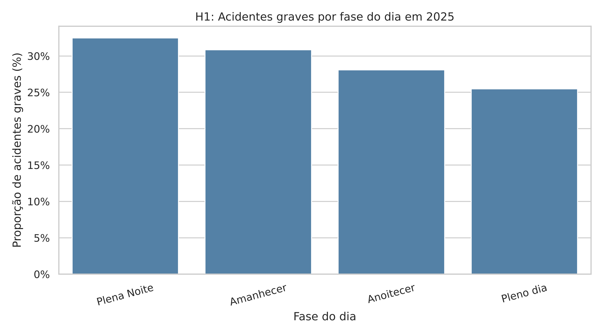
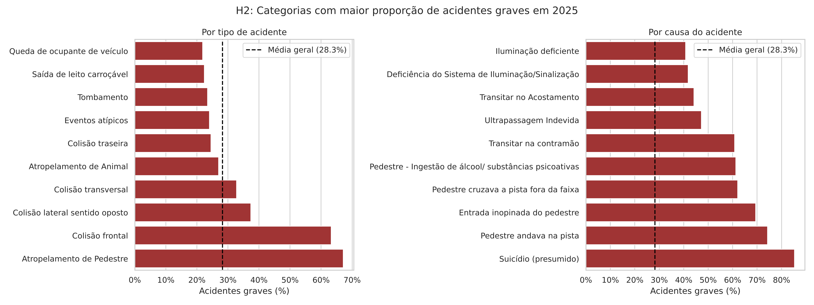
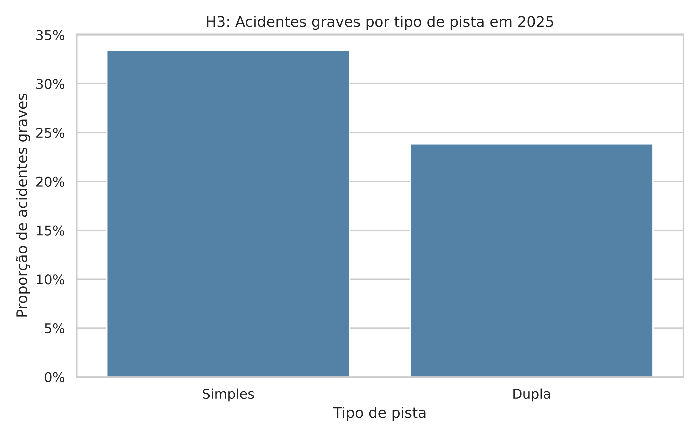
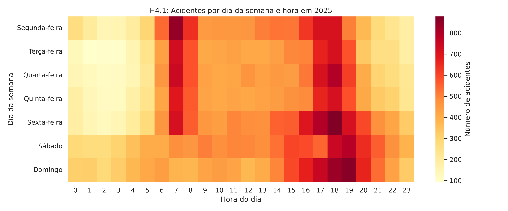
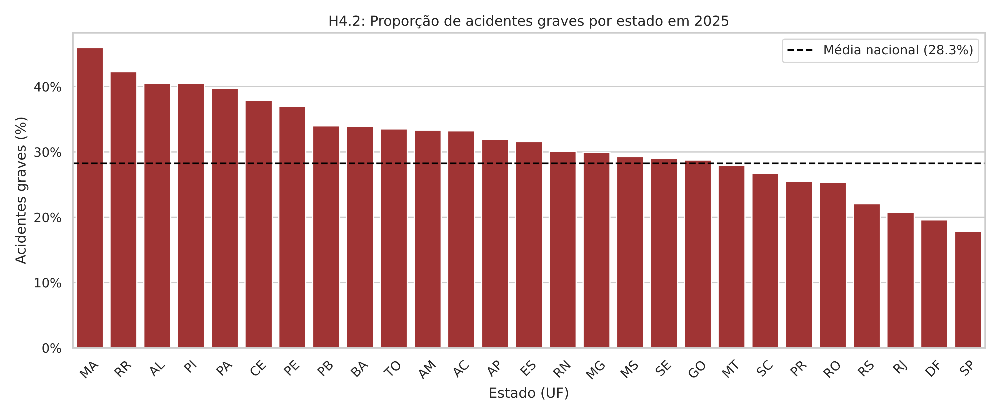

# Análise de acidentes em rodovias federais (PRF, 2025)

Análise exploratória em Python dos acidentes registrados pela Polícia Rodoviária Federal (PRF) em 2025, para entender **quais fatores estão associados aos acidentes graves**.

Projeto acadêmico em grupo (UNIJORGE, disciplina de Análise de Dados em Python).

## Pergunta

> Que características do acidente (hora do dia, tipo, causa, pista, dia da semana e estado) estão associadas a uma maior proporção de acidentes graves nas rodovias federais?

## Dados

- **Fonte:** base aberta `datatran2025.csv`, publicada pela PRF no portal de Dados Abertos (acidentes por ocorrência).
- **Período:** 01/01/2025 a 31/12/2025.
- **Tamanho:** 72.529 registros brutos, 72.528 após a limpeza.
- **Definição de acidente grave:** ocorrência com pelo menos um morto ou ferido grave. Foram 20.492 acidentes graves (28,25%), com 6.042 mortes no total.

O arquivo não está neste repositório. Baixe-o no site da PRF e salve em `data/datatran2025.csv`.

## Limpeza dos dados

- Remoção de registros sem `classificacao_acidente` e de `id` duplicados.
- Conversão de `data_inversa` para data, e de `latitude`, `longitude` e `km` para número (vírgula decimal).
- Extração da hora a partir de `horario`, aceitando `HH:MM` e `HH:MM:SS`.
- `mortos` e `feridos_graves` convertidos para número, com vazios tratados como zero.
- Criação da coluna `grave` (1 se `mortos > 0` ou `feridos_graves > 0`, senão 0).

## Hipóteses e resultados

### H1. A gravidade muda com a fase do dia?

Sim. A proporção de acidentes graves é maior à noite.

| Fase do dia | Acidentes | % graves |
|---|---|---|
| Plena noite | 24.781 | 32,48% |
| Amanhecer | 3.447 | 30,84% |
| Anoitecer | 3.926 | 28,07% |
| Pleno dia | 40.374 | 25,46% |



### H2. Certos tipos e causas de acidente são mais graves?

Sim. Entre as categorias com pelo menos 100 acidentes, as mais graves envolvem pedestres e colisões frontais (média geral: 28,3%).

| Tipo de acidente | Acidentes | % graves |
|---|---|---|
| Atropelamento de pedestre | 3.057 | 67,16% |
| Colisão frontal | 4.738 | 63,25% |
| Colisão lateral, sentido oposto | 2.152 | 37,36% |

| Causa | Acidentes | % graves |
|---|---|---|
| Pedestre andava na pista | 606 | 74,26% |
| Entrada inopinada do pedestre | 667 | 69,42% |
| Pedestre cruzava a pista fora da faixa | 525 | 62,10% |

A categoria "Suicídio (presumido)" também aparece no topo (85,26%), mas com apenas 190 registros, e não é um fator de prevenção no mesmo sentido das demais causas.



### H3. Pista simples é mais grave que pista dupla?

Sim. A proporção de acidentes graves em pista simples é cerca de 40% maior.

| Tipo de pista | Acidentes | Graves | % graves |
|---|---|---|---|
| Simples | 34.732 | 11.604 | 33,41% |
| Dupla | 30.782 | 7.338 | 23,84% |



### H4. Quando e onde os acidentes acontecem e quão graves são?

- **Volume por dia da semana:** sábado (11.554), domingo (11.470) e sexta (11.197) têm mais acidentes; terça é o dia com menos (9.062).
- **Volume por hora:** os picos são às 18h (5.398), 17h (4.845) e 19h (4.646).
- **Gravidade por estado:** varia de 17,85% em SP a 45,96% no MA (RJ: 20,75%; PI e AL: 40,54%). Estados com poucos registros, como RR (142), oscilam mais.




## Limitações

- **A análise mostra associação, não causa.** Por exemplo, acidentes noturnos serem mais graves não prova que a noite é o motivo (velocidade, cansaço e iluminação também mudam).
- **Proporção não é risco.** Não há dados de volume de tráfego ou de quilômetros rodados, então não dá para comparar o risco de dirigir em cada estado ou tipo de pista, apenas a proporção entre os acidentes registrados.
- **Só entram acidentes atendidos pela PRF**, o que pode subestimar ocorrências leves.
- **Não foram feitos testes de significância estatística.** Com esse volume de dados, diferenças pequenas tendem a ser significativas, então o tamanho da diferença importa mais que o p-valor.

## Próximos passos

- Testes estatísticos (qui-quadrado) para cada hipótese.
- Cruzar com dados de fluxo de veículos para estimar risco, e não só proporção.
- Modelo simples (regressão logística) para estimar o efeito de cada fator controlando pelos demais.

## Como rodar

```bash
pip install -r requirements.txt
# coloque datatran2025.csv em data/
python analise_acidentes_prf.py
```

Os gráficos são salvos na pasta `figuras/`.

## Tecnologias

Python, pandas, matplotlib, seaborn.

## Autores

Ruan Souto Santos, Italo Rocha Bizerra, Victor Luiz Cruz de Jesus e João Gabriel dos Santos Bispo.
